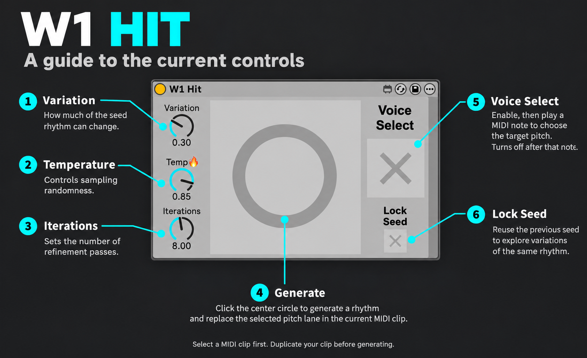

# 🎛 W1 Hit
### An AI-powered MIDI rhythm generator with Ableton Live integration

**Music is defined as a sound that repeats.**  
**Rhythm shares the same definition and thus is the basis of all music.**

## 🎥 Watch W1 Hit in Action

[](https://www.youtube.com/watch?v=ORlLNOC8kSM)



🇯🇲 Example songs created with W1 Hit:  
[Riddim 1](https://drive.google.com/file/d/1S0ALTq5Npl47KQ3VaoLrNTd0RcNZU6xY/view?usp=sharing)
[Riddim 2](https://drive.google.com/file/d/1A7YmxghzXO1f03oh6YUJPuZ4DZBoisaK/view?usp=sharing)
[Riddim 3](https://drive.google.com/file/d/1oqbPUerFjXpN8j4oxPI2FK8zR71hyeVt/view?usp=sharing)
[Riddim 4](https://drive.google.com/file/d/1FmriT6fvw6RxeZCmze80KoW9syu1PVDR/view?usp=sharing)
[Riddim 5](https://drive.google.com/file/d/1nlN0NuU6IPopbJdtyPBtL-_8HsqvXh_g/view?usp=sharing)
[Riddim 6](https://drive.google.com/file/d/1pScFUl_QNvKAiv-LaRbAAddNdTEqn_rS/view?usp=sharing)

W1 Hit is an AI system for generating expressive single-voice drum patterns. It trains on MIDI rhythms and produces musically coherent variations, fills, and new sequences that can be inserted directly into Ableton Live using a Max for Live device.

Designed for producers, sound designers, and researchers, W1 Hit focuses on controllable generation rather than randomness — allowing users to shape output using parameters such as variation and temperature.

✨ Features

🧠 Trained on single-voice MIDI drum patterns  
🎚 Generate new rhythms and variations  
🥁 Velocity-aware output (not just note placement)  
🎛 Parameter-controlled generation  
⚡ Real-time Ableton Live integration  
🎹 MIDI-native workflow (no audio preprocessing)  

🧠 How It Works

W1 Hit trains a Temporal Convolutional Network (TCN) on quantized MIDI grids of 16th notes, 8 bars each, representing a single drum voice.
During inference, the model generates new patterns conditioned on:
* training data distribution
* input samples
* user-controlled parameters
  
This enables musically coherent results suitable for production workflows.

🎛 Use Cases

* Drum pattern generation for producers  
* Creating variations of existing grooves  
* AI-assisted composition tools  
* Symbolic music generation research  
* Max for Live instrument development  

📂 Project Structure

```
W1_Hit/
│
├── Max MIDI Effect/                  # Ableton integration. If you're an artist, you only need this folder
│   └── W1_Hit/                       # Root Directory for W1 Hit. Copy this to the Max MIDI Effect folder on your computer
│       ├── w1_hit.amxd               # Max for Live device
│       ├── w1_hit.js                 # Node for Max interface
│       ├── clipcmd_to_live.js        # MIDI insertion logic
│       ├── install/                  # Folder containing dependencies and utilities to install them
│       │   ├── install_mac.command   # Installs python dependencies for mac
│       │   ├── install_win.bat       # Installs python dependencies for windows
│       │   └── requirements.txt      # List of python dependencies
│       │
│       └── w1_hit_infer/             # Inference engine
│           ├── inference.py          # Runs inference on the model in the Loader dir. The output is sent back to a MIDI clip in Ableton Live
│           ├── hit_generator.py      # Contains the model definition. Basically a stripped down version of hit_generator.ipynb
│           ├── mid_to_velocity.py    # Used to load MIDI files used as seed data for inference
│           ├── Loader/               # Dir to store the model. inference.py loads the first model it finds in this folder
│           ├── MIDI/                 # Stores MIDI files to be used as training data and as seed data for inference
│           └── random_midi_input.py  # Generates MIDI data for use as the seed input to inference, in place of MIDI files
│
├── HitGenerator/                # Training pipeline. For the more technical minded
│   ├── hit_generator.ipynb      # Jupyter notebook containing model definition. The main function can be run to train the model
│   ├── mid_to_velocity.py       # Used to load MIDI files into the training set. Each voice in the MIDI is a new sample
│   ├── midi_export.py           # For testing inference. Generates a MIDI file from the models output data
│   ├── Models/                  # The output directory for trained models.
│   ├── rename_midis.ipynb       # A Jupyter notebook used as a utility for renaming midi samples to uuids
│   └── generated_midis/         # Output directory for MIDIs generated by inference
│
├── requirements.txt
└── README.md
```
## Installation — W1 Hit 1.0.0

Requires Ableton Live 11 or later with Max for Live (Suite, or Standard with the Max for Live add-on), Max 8.5.8 or later with Node for Max, and Python 3.10–3.12. Python 3.11 is recommended. The device runs inference locally on the CPU; no API key or subscription is needed.

1. Download `W1_Hit-1.0.0.zip` from this repository's Releases page and extract it.
2. Copy the complete `W1_Hit` folder to **User Library → Presets → MIDI Effects → Max MIDI Effect**. Keep the scripts, model, and MIDI folders together with `w1_hit.amxd`.
3. Before opening the device, run `install/install_mac.command` on macOS or `install/install_win.bat` on Windows. The installer needs internet access to download Python packages and creates a `.venv` inside the device folder. It may install Python via Homebrew on macOS or winget on Windows if a compatible Python is missing. To manage Python yourself, install Python 3.11 from python.org first. Loading the device does not automatically install software.
4. Wait for the installer to report **Done**, then drag `w1_hit.amxd` onto a MIDI track before a Drum Rack or instrument.

macOS: if double-clicking the installer does not work, open Terminal, type `bash ` (with a trailing space), drag `install_mac.command` into Terminal, then press Return. This also works when the folder path contains spaces.

### Generate a pattern

1. Create or select a MIDI clip in Clip View. Use an eight-bar clip in 4/4 to hear the full generated pattern.
2. Enable **Voice Select**, play the desired drum note, then disable Voice Select. The default pitch is MIDI note 36.
3. Choose **Seed From Midi** for a random bundled MIDI seed, or turn it off and set the hit count and velocity limits. **Lock Seed** reuses the previous seed.
4. Set Variation, Fill Depth, and Temperature, then click the round Generate button. Wait for generation to finish before generating again.

**Save or duplicate your clip first.** Generation replaces the selected pitch lane in the currently selected clip (beats 0–9999); other pitches remain unchanged. Output is 128 sixteenth-note steps, or eight bars of 4/4, starting at beat zero. Notes outside the clip loop will not be heard until you extend its loop.

### Troubleshooting

Open the Max editor and Max Console for dependency or inference errors. If Python dependencies are missing, rerun the installer in the same W1_Hit folder that contains the device. If no notes appear, select an editable MIDI clip in Clip View and check the selected drum pitch. Do not move an installed `.venv` between computers; rerun the installer on each computer.

The Windows installer is included but this release's automated inference checks were performed on macOS. A full Ableton Live playback check is separate from the automated checks.

### Training your own model

The training workflow is in `HitGenerator/hit_generator.ipynb`; run its training cells with your MIDI dataset. Copy a compatible model checkpoint to `Max MIDI Effect/W1_Hit/w1_hit_infer/Loader/models/`, leaving only the model you intend to use there. Models must match the `SingleVoiceTCN` configuration expected by the inference code.

### Distribution and development

W1 Hit is MIT licensed; see LICENSE. This device requires companion Python code, model weights, and MIDI seeds and is distributed as a complete ZIP through GitHub Releases. On maxforlive.com, use an **external/reference download** listing linking to the release ZIP. Uploading the small unfrozen `.amxd` alone will omit required files. See the site's [distribution rules](https://maxforlive.com/library/zip.php).

Build the release ZIP with `python3 scripts/package_release.py`. It includes the device, runtime source, model, MIDI seeds, installer, README, and license; it excludes local virtual environments, seed caches, notebook checkpoints, and OS metadata.

🎚 Generation Parameters

W1 Hit exposes controllable parameters to shape output:
  * Variation — degree of deviation from input pattern
  * Temperature — randomness vs determinism
  * Iterations — Refinement passes  
These allow producers to dial in results that fit their groove.

🤝 Contributing
Contributions, issues, and suggestions are welcome.

🎧 About  
Created by W1NGY — a project exploring AI-assisted music production tools.

